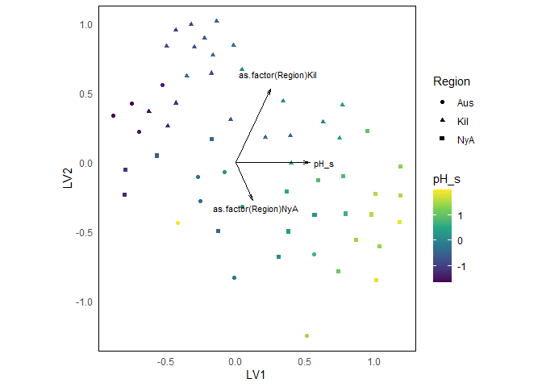
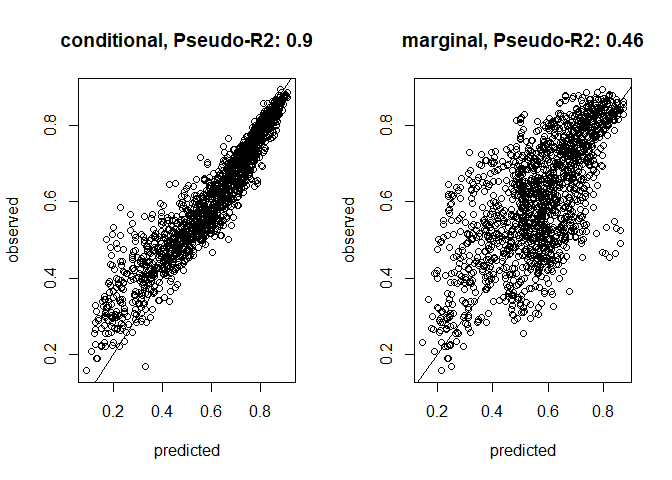
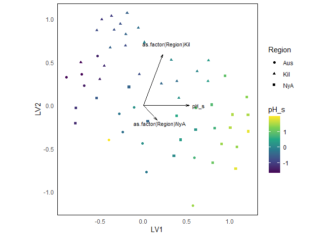

<!-- README.md is generated from README.Rmd. Please edit that file -->

# rrGDM

<!-- badges: start -->

<!-- badges: end -->

rrGDM fits reduced rank Generalised Dissimilarity Models.

## Installation

You can install the development version of rrGDM from
[GitHub](https://github.com/) with:

``` r
# install.packages("devtools")
devtools::install_github("dhercar/rrGDM")
```

## Example

Fit model

``` r
library(Matrix)
library(ggplot2)
library(cowplot)
library(gllvm)
library(rrGDM)
```

``` r
# Load data
data(microbialdata)
com <- microbialdata$Y
env <- microbialdata$Xenv
env$pH_s <- scale(env$pH)

m1 <- rrGDM(Y = com, 
            X = env, 
            k = 2, 
            seed = 2,
            formula = ~ pH_s + as.factor(Region) + (1|Site),
            formula_sd = ~ pH_s,
            family = 'binomial',
            dist_method = 'bray',
            link = 'negexp',
            constraint = 2,
            binary = TRUE)
```

Predict expected dissimilarities with parametric bootstrapping

``` r
pred_Y <- predict(m1, 
                  boot = TRUE, 
                  type = 'response',
                  site_error = TRUE)
```

Marginal pred. vs. obs:

``` r
Est_diss_m <- pred_Y[,4]
obs_dist <- m1$Y_diss / m1$Y_den
plot(Est_diss_m, obs_dist)
abline(0,1)
```



Full ordination

``` r
#### FULL ORDINATION PLOT ####
points <- data.frame(m1$X_design %*% m1$obj$report()$lambda + m1$obj$report()$u_sample)
loadings <- data.frame(var = colnames(m1$X_design), m1$obj$report()$lambda)

ggplot(points, aes(x = X1, y = X2)) +
  geom_point(aes(fill = env$pH, shape = env$Region)) +  
  geom_hline(yintercept = 0, colour = 'grey') +
  geom_vline(xintercept = 0, colour = 'grey') +
  geom_segment(data = loadings, aes(x = 0, y = 0, xend = X1, yend = X2), 
               arrow = arrow(angle = 15, length = unit(0.2, 'cm'))) +
  geom_text(data = loadings, aes(label = var, x = X1*1.2, y = X2*1.2)) +
  scale_shape_manual('region', values = c(21,22,24)) +
  scale_fill_gradientn('pH (scaled)', colours = c('steelblue', 'grey90','coral2' )) +
  coord_equal() +
  xlab('LV 1') +
  ylab('LV 2') +
  theme(legend.position = 'bottom',
        legend.title.position = 'top',
        legend.title = element_text(hjust = 0.5))
```



Partial effect of pH on average composition and its dispersion

``` r
X_pred <- expand.grid(Region = unique(microbialdata$Xenv$Region)[1],
                      pH_s = c(-2, 0, 2))

pred_ord_2  <- predict(m1,
                       X_new = X_pred, 
                       ordination = TRUE, 
                       boot = TRUE, 
                       sample_param = FALSE, # No param. uncertainty to visualise dispersion
                       site_error = TRUE, 
                       n_sim = 1000)

ggplot(pred_ord_2, aes(x = L.1, y = L.2)) +
  geom_hline(yintercept = 0, colour = 'grey') +
  geom_vline(xintercept = 0, colour = 'grey') +
  stat_ellipse(geom = 'polygon',aes(group = as.factor(pH_s)),fill = 'white', level = 0.50) + 
    stat_ellipse(geom = 'path',aes(col = as.factor(pH_s)), level = 0.95, lty = 5) + 
    stat_ellipse(geom = 'polygon',aes(fill = as.factor(pH_s)), level = 0.50, alpha = 0.5) + 
    scale_colour_viridis_d('pH (scaled)',  guide = 'none') + 
    scale_fill_viridis_d('pH') + 
    coord_equal() +
  ggtitle('pH') +
    xlab('LV 1') +
    ylab('LV 2')
```


